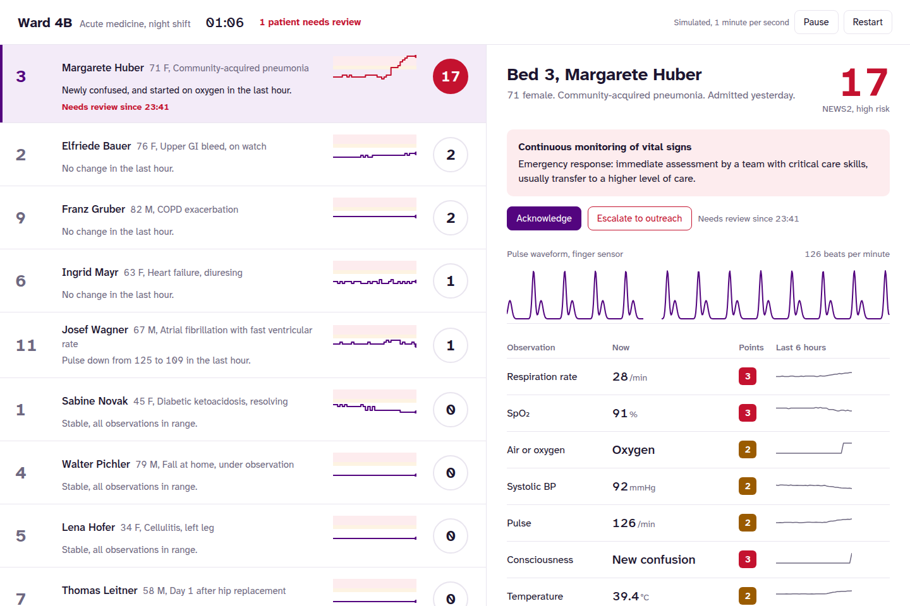
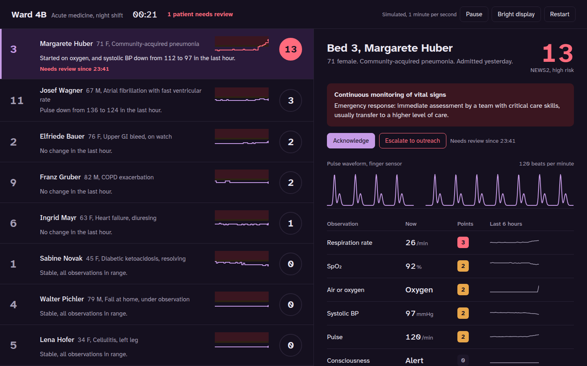

# Ward 4B monitor

Live: https://ward-monitor.vercel.app

A ward early-warning monitor for the night shift. It answers the question a nurse
covering twelve beds actually has: who is getting worse, and why.



Bedside monitors already show numbers. The problem on a ward is not missing data; it is
too many alarms and too little sense of direction. A nurse who silences thirty alarms a
shift stops hearing them. This interface is built around three choices:

- **Sorted by need, not by bed number.** Patients waiting for review come first, then by
  risk and score. When a patient deteriorates, their row moves up the list, visibly.
- **Trajectory, not just the latest value.** Every row carries six hours of NEWS2 as a step
  line over the 5 and 7 thresholds, so "17 and climbing" and "5 and recovering" look different.
- **One sentence on what changed.** "Newly confused, and started on oxygen in the last hour."
  Written from the observations, in the words a handover would use.

The selected patient shows the NEWS2 response the score requires (who to call, how often to
observe), a live pulse waveform at the patient's current rate, every observation with its
points, and six-hour trends on fixed clinical ranges, so noise looks like noise and a real
change looks like one.

## Clinical logic

NEWS2 is implemented from the Royal College of Physicians 2017 chart, including:

- SpO₂ scale 2 for confirmed hypercapnic respiratory failure (Bed 9, COPD). The same patient
  scored on scale 1 would trigger an urgent response for being at his prescribed target.
- A single parameter scoring 3 raises the risk to low-medium even when the total is low (Bed 11,
  atrial fibrillation at 138).
- New confusion scores 3 on its own.
- Responses and observation frequency per risk band.

Acknowledging a patient sets a reassessment time (30 minutes at high risk, 60 otherwise). An
overdue reassessment, or a rise to a higher risk band, puts the patient back at the top.

59 tests cover every NEWS2 band edge from both sides, both SpO₂ scales, the risk rules, the
simulated patient courses, and the acknowledge and escalate workflow.

## The simulated ward

Eleven fictional patients follow common ward courses from 18:00: pneumonia progressing to
sepsis (Bed 3), a slow GI bleed (Bed 2), resolving diabetic ketoacidosis (Bed 1), COPD on
scale 2, fast atrial fibrillation, and stable patients. One bed is empty, waiting for an
admission. The simulation runs at one minute per second from 23:00. Add `?at=01:00` to the
URL to open at any time between 18:00 and 04:00.

The pulse waveform uses the same two-wave pulse shape as the tests for my
[pulse monitor firmware](https://github.com/Henrycarto/pulse-monitor-avr).

## Design

- **Typeface:** Atkinson Hyperlegible Next, designed by the Braille Institute for low-vision
  legibility, with tabular figures, bundled with the app rather than loaded from a font host,
  so it works on hospital networks that block third-party requests.
- **Colour:** white and one purple for interaction. Amber and red appear only where NEWS2 says
  they should, so colour always means something clinical.
- **Dim display** for a dark ward at night, following the system setting or the button.
- **Keyboard:** arrow keys move between patients, A acknowledges, space pauses.
- Works on a phone: the list and the patient view become two screens.



## Run it

```bash
npm install
npm run dev
npm test && npm run lint && npm run typecheck
npm run build          # static site in dist/
npm run build:single   # one self-contained HTML file in dist-single/
```

## Not a medical device

Fictional patients and simulated data, for demonstrating interface design and NEWS2 logic.
It is not validated for clinical use and must not be used to make clinical decisions.

## Author

Samuel Henry Mba
